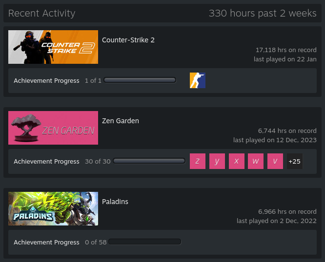

# steam-hour-booster
> Farm your in-game hours on Steam
- You can farm hours for **multiple games** on **multiple accounts** at once.
- Accounts with **Steam Guard** enabled are **supported**.
- Uses [node-steam-user](https://github.com/DoctorMcKay/node-steam-user) library.

<sub>*This software is not affiliated with Valve Corporation or Steam.*</sub>



## Requirements
- [Bun](https://bun.sh/) (or [Docker](https://www.docker.com/))

## Usage

Install dependencies:
```bash
bun install
```

Run:
```bash
bun .
```

### Steam Guard
If your accounts have Steam Guard enabled, you will be prompted to enter Steam Guard code for each account.
Once logged in, a [refresh token](https://github.com/DoctorMcKay/node-steam-user?tab=readme-ov-file#using-refresh-tokens) will be stored and used to automatically log in to your accounts in the future.

### Run in the background
To take full advantage of this program, you most likely want to run it on a machine that is always running.\
I recommend using [Docker](#docker) to achieve this, but you are free to use your own solution.

*Before running in the background, make sure to run it once normally to be able to enter your Steam Guard codes (if needed).*

## Configuration

Copy the default configuration:

```bash
cp config.example.json config.json
```

Edit the configuration file to your liking.

*Example configuration:*

```jsonc
[
    {
        "username": "foo",
        "password": "bar",
        "games": [730, 252490, 578080],
        "online": true,
        "CustomStatus": "gg",
        "forceStatus": false
    }
]
```

You can add as many accounts as you want.

| Option | Type | Default | Description |
| --- | --- | --- | --- |
| `username` | `string` | — | Steam account username |
| `password` | `string` | — | Steam account password |
| `games` | `number[]` | — | Array of [Steam App IDs](https://steamdb.info/) to farm (max 32) |
| `online` | `boolean` | `false` | Appear online & in-game while farming |
| `CustomStatus` | `string \| boolean` | — | Custom playing status (see below) |
| `forceStatus` | `boolean` | `false` | Force custom status even when Steam client is open (see below) |

### Custom Playing Status

| Value | Behavior |
| --- | --- |
| *omitted* or `false` | Native display — shows the first game in your list (e.g. `In-Game: Counter-Strike 2`) |
| `"gg"` (any string) | Shows your custom text to friends |
| `true` | Auto-fetches game names and combines them (e.g. `Counter-Strike 2 & Rust & PUBG`) |

> **Note:** `"online": true` must be set, otherwise your status will remain Offline/Invisible.

### Auto Mode vs Force Mode

The bot automatically detects if your local Steam client is running:

| | Steam client **open** | Steam client **closed** |
| --- | --- | --- |
| **Default** (`forceStatus: false`) | Local mode — games show **"Running"** in your sidebar, no custom status | Remote mode — custom status shown to friends |
| **Force** (`forceStatus: true`) | Forces TCP login — custom status shown, local idlers disabled | Remote mode — same behavior |

> **Warning:** When `forceStatus` is enabled and Steam client is open, your PC Steam session may show a `LoggedInElsewhere` prompt. This is expected — the bot takes over the session to display your custom status.

## Environment variables
You can provide a `.env` file to configure environment variables. You probably won't need to modify these.

Copy the template:
```bash
cp .env.example .env
```

| Name | Description | Default value |
| --- | --- | --- |
| `CONFIG_PATH` | Path to the config file | `./config.json` |
| `STEAM_DATA_DIRECTORY` | Path to the directory where Steam will store it's data | `./steam-data` |
| `TOKEN_STORAGE_DIRECTORY` | Path to the directory where Steam refresh tokens will be stored, used for remembering sessions | `./tokens` |
| `STEAM_API_DLL_PATH` | Optional: Absolute/relative path to `steam_api.dll` | Project root folder, then system search |
| `BIN_DIRECTORY` | Optional: Path to custom bin directory for compiled C# helper | `./bin` |

## Docker

For Docker usage, see [here](https://hub.docker.com/r/drwarpman/steam-hour-booster).

## FAQ

### Can I get banned?
People have been using these kinds of "hour boosters" for years, without issues.\
Don't take my word for it though, use at your own risk.
